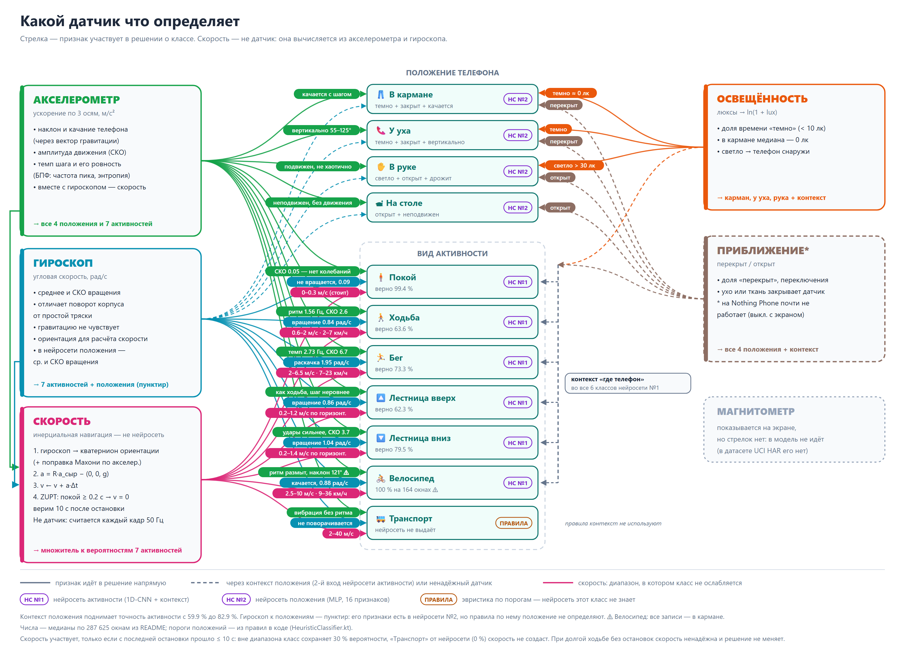

# Распознавание активности пользователя по данным датчиков

Android-приложение непрерывно определяет тип физической активности пользователя
по данным пяти датчиков телефона, показывает решение на экране и ведёт журнал.

**Классы активности:** покой, ходьба, бег, подъём по лестнице, спуск по
лестнице, велосипед. Транспорт исключён: приложение распознаёт активность
самого человека, а не способ передвижения.
**Положение телефона:** в кармане, в руке, у уха, на столе.

Решение принимают две модели TensorFlow Lite, лежащие в `app/src/main/assets/`.
Если их там нет, приложение работает на эвристическом классификаторе по явным
правилам и честно сообщает об этом в интерфейсе.

---

## Что в репозитории

```
app/src/main/java/com/example/har/
├── sensors/
│   ├── SensorSample.kt      кадр показаний + доступность датчиков
│   ├── SensorHub.kt         подписка на 5 датчиков, сетка 50 Гц, выделение гравитации
│   └── SlidingWindow.kt     кольцевой буфер, нарезка на перекрывающиеся окна
├── motion/
│   ├── InertialSpeedEstimator.kt  ориентация (гироскоп + акселерометр + магнитометр),
│   │                              земные оси, скорость, ZUPT, курс и поле
│   └── StepDetector.kt      шаги, темп, длина шага по Вайнбергу, скорость по шагам
├── features/
│   ├── Fft.kt               БПФ Кули — Тьюки с окном Ханна
│   └── FeatureExtractor.kt  вход моделей + интерпретируемая сводка окна
├── ml/
│   ├── Labels.kt            классы активности и положения
│   ├── ModelMeta.kt         чтение и валидация model_meta.json
│   ├── TfLiteModel.kt       обёртка над интерпретатором TFLite
│   ├── HeuristicClassifier.kt  резервный классификатор на правилах
│   ├── SpeedFusion.kt       уточнение вероятностей активности по скорости
│   ├── PlacementFusion.kt   физические поправки положения: свет, приближение, поза у уха, дрожь руки
│   ├── PlacementConditioning.kt  активность с учётом положения (этап 2)
│   ├── MotionFusion.kt      уточнение по шагам, темпу и движению рукой
│   ├── ProbabilitySmoother.kt  сглаживание + гистерезис
│   └── ActivityRecognizer.kt   конвейер: окно → признаки → модель → класс
├── data/
│   ├── db/                  Room: окна, интервалы, DAO
│   ├── LogRepository.kt     ведение журнала, слияние окон в интервалы
│   └── CsvExporter.kt       выгрузка через FileProvider
├── collect/DatasetRecorder.kt   запись размеченного датасета
├── google/GoogleActivityTracker.kt  Google Activity Recognition — эталон для сверки
├── service/
│   ├── RecognitionEngine.kt     конвейер и его состояние (живёт в Application)
│   └── RecognitionService.kt    передний сервис: работа при погашенном экране
└── ui/                      Compose: «Сейчас», «Скорость», «Датчики» (графики),
                             «Журнал», «Сбор данных», «О модели»

ml/
├── features.py      зеркало FeatureExtractor.kt (признаки положения)
├── datasets.py      загрузка UCI HAR, RealWorld HAR, MotionSense, Shoaib,
│                    ExtraSensory и собственных CSV
├── train.py         обучение обеих моделей и экспорт в assets
├── crossval.py      честная проверка на своих записях: обучение без одного дня
├── evaluate.py      проверка экспортированных .tflite
└── report.py        генерация раздела с числами в конце этого файла
```

Данные обучения (`ml/data/`) в репозиторий не входят: это несколько гигабайт
публичных датасетов, которые `datasets.py` скачивает и кэширует сам.

### Источники обучения

Чтобы модель не подстраивалась под одного человека, собственные записи
только добавляются к публичным наборам, а точность проверяется на людях,
которых модель при обучении не видела (деление по испытуемым).

| Источник | Люди | Положения телефона | Чем полезен |
|---|---|---|---|
| UCI HAR | 30 | пояс | базовая выборка ходьбы, лестницы и покоя |
| RealWorld HAR | 15 | 7 мест на теле, бедро = карман, голова = у уха | освещённость, разные места на теле |
| MotionSense | 24 | передний карман (iPhone) | ещё 24 человека в кармане, лестница, бег |
| Shoaib et al. | 10 | карманы, запястье, плечо, пояс | велосипед и лестница, магнитометр |
| ExtraSensory | 60 | карман, рука, стол; у уха — «разговор + датчик закрыт» | обычная жизнь, свет и приближение у Android |
| собственные записи | — | все четыре | ситуации, которых нет в публичных наборах |

Все источники приводятся к виду приложения: 50 Гц, ускорение в м/с² вместе
с гравитацией, гироскоп в рад/с, оси Android. У iPhone (MotionSense,
часть ExtraSensory) ускорение записано в g с обратным знаком, поэтому
`acc = −9.80665 · a`. Разметка ExtraSensory ставилась людьми раз в минуту
и бывает неверной, поэтому окна, где сигнал противоречит метке («ходьба»
без движения, «на столе» с тряской), отбрасываются. Из ExtraSensory
скачиваются только нужные минуты (HTTP Range по архивам на 6–10 ГБ),
не больше `--extrasensory-max-minutes` на сочетание «активность × положение»
у одного человека.

```
python ml/train.py --source all          # все шесть источников
python ml/train.py --source uci,motionsense,shoaib,extrasensory,own
```

Shoaib распространяется в RAR: его распаковывает 7-Zip, а если его нет —
встроенный в Windows 10+ `tar`. Разобранные датасеты кэшируются в
`ml/data/cache/*.npz`, повторное обучение их не перечитывает. Если сервер
датасета недоступен или отдаёт данные по капле, источник пропускается,
а не останавливает обучение. Данные публичных
наборов можно использовать в исследовательских целях со ссылкой на авторов
(MotionSense — MIT; Shoaib и ExtraSensory — «со ссылкой на статью»).

### Как обучаются модели

Модели в `app/src/main/assets` обучены на UCI HAR, RealWorld, MotionSense,
Shoaib и собственных записях. ExtraSensory в них не вошёл: при обучении
сервер датасета отдавал данные со скоростью сотни байт в секунду.

**Модель активности** видит только акселерометр и гироскоп, в единицах
Android, как их отдаёт телефон. Нормировка встроена в саму модель,
поэтому в `model_meta.json` среднее 0 и СКО 1. Внутри сеть дополняет
шесть осей пятью величинами, которые не зависят от того, как телефон
повёрнут в кармане или в руке:

- модуль ускорения;
- вертикальная составляющая ускорения — проекция на направление тяжести;
  она различает лестницу и ровную ходьбу;
- горизонтальная составляющая;
- модуль вращения;
- вращение вокруг вертикали.

Дальше идёт остаточная одномерная свёрточная сеть: около 460 тыс.
параметров, 1.8 МБ в `.tflite`. Свет и приближение она не видит, а
магнитометр не использует: рядом с металлом поле искажается сильнее,
чем меняется от движения.

При обучении:

- каждое окно случайно поворачивается (σ = 20°) и с вероятностью 45 %
  переворачивается на 180°: так телефон по-разному лежит в кармане;
- сила движения меняется на ±15 %, добавляется шум датчиков;
- собственные записи получают 30 % общего веса: только они сняты этим
  телефоном;
- внутри собственных записей редкие сочетания «активность × положение»
  весят больше. Иначе час покоя в руке заглушил бы минуту ходьбы в руке;
- классы уравнены по весу;
- скорость обучения проходит весь косинусный график, без ранней остановки.
  Валидация — чужие люди, её потери скачут, и ранняя остановка выбирала бы
  эпоху почти случайно.

**Модель положения** — небольшая полносвязная сеть по 16 признакам окна
(свет, приближение, наклон, статистики движения). В RealWorld телефоны
на бедре и голове закреплены поверх одежды, и «бедро» там бывает на
свету до тысяч люкс. В настоящем кармане темно, поэтому для этих окон
освещённость считается неизмеренной. Без этого модель училась, что
карман бывает светлым, и принимала ходьбу с телефоном в руке за карман.

**Проверка на своих записях** (`ml/crossval.py`). Для каждого дня записей
модели обучаются без этого дня и проверяются на нём `.tflite`-файлом,
ровно так, как модель работает в приложении. Полнота по сочетаниям
(доля окон, распознанных верно) на записях 20.09–09.10:

| Запись | Окон | Активность | Положение | Прежняя модель, активность |
|---|---|---|---|---|
| Велосипед, карман | 2160 | 97 % | 99 % | 99 % |
| Ходьба, карман | 493 | 98 % | 100 % | 36 % |
| Подъём, карман | 114 | 95 % | 100 % | 0 % |
| Спуск, карман | 97 | 97 % | 96 % | 30 % |
| Покой, в руке | 2508 | 100 % | 100 % | 100 % |
| Ходьба, в руке | 109 | 35 % | 92 % | 100 % |
| Подъём, в руке | 47 | 64 % | 66 % | 0 % |
| Покой, на столе | 58 | 100 % | — | 95 % |

Прежняя модель обучалась на записях 20.09, поэтому её цифры по ним
завышены. Положение «на столе» записано только в один день, и проверить
его так нельзя. Его подстраховывает правило в `PlacementFusion`: телефон,
который лежит строго плашмя и совсем не дрожит, никто не держит в руке.

Слабое место — ходьба с телефоном в руке. Две такие записи сильно
различаются (телефон почти горизонтально и верхом вниз), и по двум
записям модель не может обобщить, как его держат. Что записать, чтобы
стало точнее:

- ходьба и лестница с телефоном в руке — несколько записей по 1–2 минуты,
  днём и вечером, держа по-разному;
- телефон на столе, экраном вверх и вниз;
- разговор у уха — такой записи нет совсем;
- бег — тоже нет.

```
python ml/crossval.py --source uci,realworld,motionsense,shoaib,own --compare-assets app/src/main/assets
```

### Сверка с Google Activity Recognition

Рядом с собственным решением приложение записывает ответ Google Activity
Recognition API из Play Services (нужно разрешение «Физическая активность»).
В решение он не входит: это эталон, по которому видно, где мы расходимся.
Google не знает положения телефона и не различает лестницу, поэтому подъём
и спуск сравниваются с его «ходьбой», а его «транспорт», «наклон» и
«неизвестно» не сравниваются вовсе. На экране «Сейчас» — карточка
«Сверка с Google» с процентом совпадений за сессию; в журнале и CSV —
`google_activity`, `google_confidence`, `google_agrees`.

## Сборка

Нужны **JDK 21** (Gradle 8.9 не работает на JDK 25, встроенном в Android
Studio 2026.1 — переключите *Settings → Build, Execution, Deployment → Build
Tools → Gradle → Gradle JDK*) и **Android SDK** Platform 35,
Build-Tools 35.0.0. minSdk 26.

```bash
./gradlew testDebugUnitTest    # модульные тесты обработки сигнала
./gradlew assembleDebug        # APK в app/build/outputs/apk/debug/
./gradlew installDebug         # установка на подключённый телефон
```

Нужны переменные окружения `JAVA_HOME` и `ANDROID_HOME`, либо файл
`local.properties` со строкой `sdk.dir=C:/Users/<имя>/AppData/Local/Android/Sdk`.
Слэши прямые: в формате `.properties` обратный слэш экранирует, и путь
с `\` разберётся неверно.

Эмулятор не подойдёт — у него нет настоящих датчиков движения. Пакет
`com.example.har` — заглушка; для публикации переименуйте его и поправьте
`applicationId` и `namespace` в `app/build.gradle.kts`.

Пересчитать раздел с числами в конце файла:

```bash
python ml/report.py --write-readme       # все источники, несколько минут
python ml/report.py --source own+uci     # быстро, без RealWorld
```

---

## Что показывает экран во время записи

Экран «Сейчас» обновляется непрерывно и содержит три блока: сырые показания
датчиков, признаки последнего окна и статистику сессии. Ниже разобрано, что
означает каждое значение и откуда оно берётся.

### Блок «Показания датчиков» — то, что отдаёт железо

Это мгновенный кадр без усреднения, он меняется десятки раз в секунду. Общее
назначение каждого датчика:

| Датчик | Измеряемая величина | Единица | Роль в распознавании |
|---|---|---|---|
| Акселерометр | собственное ускорение, три оси | м/с² | основной сигнал: амплитуда и ритм движения |
| Гироскоп | угловая скорость, три оси | рад/с | вращение корпуса: повороты, раскачка |
| Магнитометр | магнитная индукция, три оси | мкТл | изменение курса и близость металла |
| Приближение | расстояние до препятствия | см, фактически бинарно | телефон в кармане, в сумке или у уха |
| Освещённость | освещённость | лк | темно (карман) или светло (в руке) |

Опрашиваются с разной частотой: акселерометр и гироскоп на 100 Гц, магнитометр
на 50 Гц, приближение и освещённость событийно (`SENSOR_DELAY_NORMAL`, единицы
герц). Дальше всё сводится к единой сетке 50 Гц. Ниже — что именно каждая
из этих величин означает физически.

#### Акселерометр: собственное ускорение и ускорение свободного падения

Внутри — MEMS-структура: подвижная масса на упругих подвесах, её смещение
относительно корпуса меняет ёмкость между гребёнками электродов, и эта ёмкость
преобразуется в число. Но масса смещается не от «ускорения телефона», а от силы,
которая действует на неё со стороны подвеса. Поэтому датчик измеряет
**собственное (кажущееся) ускорение** — сумму ускорения корпуса и реакции опоры,
компенсирующей вес. В Android это `TYPE_ACCELEROMETER`, единица — м/с².

Отсюда три следствия, без которых числа на экране читаются неверно.

**Лежащий телефон показывает не ноль, а 9.81.** Стол давит на телефон снизу
с силой, равной весу, и датчик регистрирует именно её. Модуль вектора равен
ускорению свободного падения g = 9.80665 м/с² — эта константа зашита
в `FeatureExtractor.G` и используется для нормировки. Ноль акселерометр покажет
в противоположной ситуации: в свободном падении опоры нет, и брошенный телефон
покажет ноль, а лежащий — g.

**Распределение g по осям зависит от поворота, а не от движения.** Телефон
экраном вверх на столе: `az ≈ +9.81`, `ax ≈ ay ≈ 0`. Поставленный вертикально:
`ay ≈ 9.81`. В кармане под произвольным углом — произвольная тройка чисел, сумма
квадратов которых по-прежнему даёт g². Поэтому судить о движении по отдельным
осям нельзя: они меняются, когда человек всего лишь повернулся.

**Гравитацию убирают дважды, двумя разными способами.**

1. *Векторно* — чтобы получить и ориентацию, и линейное ускорение. `SensorHub`
   пропускает каждую ось через фильтр нижних частот:
   `grav ← α·grav + (1 − α)·acc` при α = 0.9. На частоте 50 Гц это постоянная
   времени около 0.2 с: вектор успевает следить за поворотом телефона, но
   не реагирует на шаги, потому что шаг — это 1.5–2 Гц, то есть быстрее.
   Остаток `acc − grav` и есть ускорение движения, а из самого вектора `grav`
   получаются наклон телефона и стабильность ориентации.

2. *Скалярно* — перед спектром. Признаки считаются по модулю
   `|acc| = √(ax² + ay² + az²)`, потому что модуль не зависит от поворота.
   Но у модуля есть постоянная составляющая около g, и если подать его в БПФ
   как есть, почти вся энергия уйдёт в нулевой бин, а полезные 1–5 Гц потонут
   на его фоне. Поэтому перед спектром вычитается среднее по окну.

Насколько g доминирует, видно по данным. Средний модуль ускорения меняется
от 9.77 м/с² у покоя до 11.35 у бега — то есть на 16 %. СКО того же модуля
за то же время меняется от 0.05 до 6.66, то есть в 130 раз. Вся информация
о классе лежит в отклонениях от g, а не в самой величине; поэтому средний
модуль ни для одного класса не оказался различающим признаком.

#### Гироскоп: угловая скорость

Измеряется **угловая скорость**, а не угол: насколько быстро телефон
поворачивается вокруг каждой из трёх своих осей. Единица — радиан в секунду,
1 рад/с ≈ 57.3 °/с. Принцип тот же MEMS, но работает сила Кориолиса: внутри
вибрирует масса, при повороте корпуса на неё действует сила, перпендикулярная
и колебанию, и оси вращения, и это отклонение измеряется.

Главное отличие от акселерометра — гироскоп **не чувствует гравитацию**.
Неподвижный телефон, как бы он ни был повёрнут, показывает ноль по всем осям.
Поэтому гироскоп различает случаи, в которых акселерометр бессилен: телефон
может трястись, не поворачиваясь (транспорт на неровной дороге), и
поворачиваться, почти не трясясь (велосипед).

Угол можно получить интегрированием угловой скорости, но ошибка при этом
накапливается и уходит в дрейф, поэтому приложение не интегрирует, а пользуется
скоростью напрямую. Ориентацию оно берёт из вектора гравитации, а не из
гироскопа.

#### Магнитометр: магнитная индукция

Измеряется **магнитная индукция** (плотность магнитного потока) по трём осям,
единица — микротесла. Поле Земли даёт 25–65 мкТл в зависимости от широты.
Принцип — эффект Холла либо магниторезистивный элемент.

Датчик показывает сумму поля Земли и локальных искажений от всего железного
рядом. Отсюда двойная польза: по направлению поля определяется курс, а по резким
искажениям — близость крупных металлических масс, то есть косвенно транспорт.

В нейросеть магнитометр не попадает, и это осознанный компромисс, а не
упущение. Модель обучается на пересечении каналов трёх источников, а в UCI HAR
магнитометра нет, поэтому в сеть идут 6 каналов — три оси акселерометра и три
гироскопа. Подмешивать нулевой магнитометр там, где его не измеряли, значило бы
учить сеть на артефакте, которого на устройстве не бывает.

#### Датчик приближения: расстояние до препятствия

Формально измеряется **расстояние** до ближайшего препятствия перед экраном,
единица — сантиметры. Физически: инфракрасный светодиод подсвечивает, фотодиод
рядом измеряет отражённый свет, и по его интенсивности оценивается расстояние.
У большинства телефонов датчик фактически бинарный — отдаёт либо 0, либо своё
`maximumRange`. Поэтому приложение не сравнивает с нулём, а берёт порог
в половину `maximumRange` (по умолчанию 5 см) и превращает показание
в «перекрыт / открыт».

На Nothing Phone (A059) этот датчик оказался бесполезен: он расположен под
экраном и отключается вместе с ним, поэтому даже в записях «в кармане»
показывает «перекрыт» лишь 0–0.4 % времени вместо ожидаемых ста процентов.
Признак `prox_near_ratio` в модель подаётся, но информации не несёт.

#### Датчик освещённости: освещённость

Измеряется **освещённость** — световой поток на единицу площади, единица люкс
(1 лк = 1 лм/м²). Это фотометрическая, а не энергетическая величина: фотодиод
снабжён фильтром, приводящим его спектральную чувствительность к чувствительности
человеческого глаза, поэтому люксы описывают «сколько света для человека»,
а не полную мощность излучения.

Порядки величин: карман или закрытая сумка — 0 лк, освещённое помещение —
100–500, пасмурная улица — несколько тысяч, прямое солнце — до 100 000.
Динамический диапазон огромный, поэтому в признак подаётся не само значение,
а логарифм: `ln(1 + lux) / ln(1 + 40000)`. Порог темноты — 10 лк
(`DARK_LUX_THRESHOLD`).

Этот датчик работает: медиана в кармане — 0 лк. Он основной для различения
кармана и руки и влияет также на распознавание активности, потому что один и тот
же рисунок ускорения означает разное, когда телефон в кармане и когда лежит
на столе.

Если датчика в телефоне нет, строка показывает «нет датчика», а соответствующие
признаки подаются в модель нулями.

### Как из показаний получаются признаки

```
5 датчиков ──► SensorHub ──► SlidingWindow ──► FeatureExtractor ──► модели ──► SpeedFusion ──► MotionFusion
  разные       единая сетка   окна 128 отсчётов    сводка окна             ▲               ▲
  частоты         50 Гц       (2.56 с, сдвиг 64)   + 16 для моделей        │               │
                    │                ▲                                     │        положение телефона
                    │                │ производные величины каждого кадра  │        (определяется первым)
                    └──► InertialSpeedEstimator ──► StepDetector ──────────┘
                         земные оси, курс, поле     шаги, темп, скорость по шагам
```



Датчики Android отдают события с разной и плавающей частотой. `SensorHub`
приводит их к единой сетке 50 Гц: акселерометр задаёт такт, остальные каналы
подставляются последним известным значением. Кольцевой буфер выдаёт окна по
128 отсчётов со сдвигом 64, то есть с перекрытием 50 %, — решение принимается
каждые 1.28 с.

### Блок «Признаки окна (2.56 с)» — то, на что смотрит модель

Эти числа не измеряются датчиками напрямую — это производные величины,
посчитанные по окну из 128 отсчётов. Именно они объясняют, почему выбран тот
или иной класс. Первые пять описывают движение и не зависят от того, как
повёрнут телефон, следующие две — наоборот, описывают только положение,
последняя — скорость по инерциальной навигации. Величины в земных осях, шаги
и магнитное поле — в разделе «Промежуточные величины» ниже.

**СКО ускорения**, м/с² — насколько сильно модуль ускорения отклоняется от
своего среднего за окно, то есть амплитуда движения. У лежащего телефона это
сотые доли, у ходьбы около 2.6, у бега 6.7.

**Частота главного пика**, Гц — самая сильная частота в полосе 0.5–5 Гц,
в которой лежит человеческая локомоция. Для ходьбы и бега это буквально темп
шага: 1.56 Гц — примерно 94 шага в минуту. Считается через БПФ с окном Ханна,
подавляющим растекание спектра на краях окна. У покоя это число
бессмысленно — периодики нет, и максимум приходится на шум.

**Мощность главного пика**, м/с² — амплитуда этой самой сильной частоты.
Показывает, насколько ритм выражен: у ходьбы около 1.3, у велосипеда 0.5,
у покоя 0.01. Вместе с частотой отвечает на вопрос «есть ли вообще ритм
и какой он».

Раньше на этом месте экрана стояла строка «СКЗ линейного ускорения», но она
всегда показывала то же число, что и СКО ускорения: в `FeatureExtractor.stats`
линейное ускорение получается вычитанием среднего модуля, а среднеквадратичное
значение такой величины — это по определению её СКО, разница ровно ноль.
Строка заменена на мощность пика, которая уже считалась и использовалась
эвристикой, но на экран не выводилась. В таблицах ниже СКЗ приводится
в честном виде — после вычитания вектора гравитации.

**Спектральная энтропия**, нат — информационная мера того, насколько энергия
размазана по частотам. Считается как энтропия Шеннона от спектра мощности,
нормированного до распределения; «нат» — натуральные единицы, потому что
логарифм берётся натуральный, а не двоичный.
Низкая означает, что почти всё сосредоточено в одном пике, то есть движение
периодично. Это главное различие между шагом и тряской: у ходьбы около 1.57,
у покоя и велосипеда около 2.0.

**Среднее вращение**, рад/с — средний модуль угловой скорости за окно.
Отличает движения, при которых корпус телефона поворачивается, от тех, при
которых он только трясётся.

**Наклон телефона**, ° — угол между усреднённым вектором гравитации и осью Z.
0° — экран смотрит вверх, 90° — телефон стоит вертикально. Признак не про
активность, а про положение: у уха телефон почти вертикален.

**Стабильность ориентации**, безразмерная — среднее СКО трёх компонент
единичного вектора гравитации за окно. Ноль означает, что телефон не
поворачивался вовсе. Растёт вместе с раскачкой корпуса: у покоя 0.00,
у ходьбы 0.05, у бега 0.14.

**Скорость (инерц. навигация)**, км/ч — горизонтальная скорость, посчитанная
по акселерометру и гироскопу (см. раздел «Скорость по инерциальной навигации»).
В отличие от остальных строк, она считается не по окну, а накапливается кадр
за кадром. Пока с последней остановки прошло не больше 10 с, число участвует
в решении. Позже рядом пишется «ненадёжно» и сколько секунд прошло без остановки.

### Промежуточные величины: земные оси, шаги, магнитометр

Новых датчиков здесь нет — всё считается из тех же акселерометра, гироскопа
и магнитометра. Смысл в том, чтобы отделить движение тела от движения
телефона: сырые оси зависят от того, как телефон повёрнут и что с ним делает
рука, а величины ниже — нет. Все они показываются на экране «Сейчас»
и пишутся в журнал окон (база данных версии 3).

**Движение в земных осях.** Ориентация из `InertialSpeedEstimator` позволяет
разложить линейное ускорение на вертикаль Земли и горизонталь:

- *вертикальное ускорение (СКЗ)*, м/с² — подпрыгивание тела при шаге. Одинаково
  видно в кармане, в руке и у уха;
- *горизонтальное ускорение (СКЗ)*, м/с² — разгон, торможение, мах руки;
- *доля вертикали*, % — у ходьбы и бега высокая, у транспорта низкая;
- *рывок (СКЗ)*, м/с³ — производная модуля ускорения, резкость: у транспорта
  мала, у шага и жестов велика;
- *размах наклона*, ° — насколько качается телефон за окно (мах руки или бедра);
- *поворот корпуса*, рад/с — угловая скорость вокруг вертикали Земли, то есть
  повороты человека, а не кручение телефона в пальцах.

**Шаги** (`motion/StepDetector.kt`). Шаг ищется по вертикальному ускорению:
ФНЧ 3 Гц, затем пик выше порога после провала ниже порога (гистерезис),
не чаще 4 раз в секунду и не реже раза в 2 с. Пороги подстраиваются под
амплитуду последних шагов. Из шагов получаются:

- *темп*, шаг/мин — по среднему интервалу последних четырёх шагов;
- *регулярность шага*, 0–1 — максимум автокорреляции вертикального ускорения
  на лагах 0.3–1.2 с (метод Мое-Нильссена). У ровной ходьбы около 0.8,
  у тряски и жестов около нуля;
- *длина шага* по формуле Вайнберга L = K·(a_max − a_min)^¼ и *скорость по
  шагам* = темп × длина. Коэффициент K зависит от положения телефона
  (в кармане 0.42, в руке и у уха 0.50) и берётся по вероятностям последнего
  решения классификатора положения. Значения K — начальное приближение,
  их стоит откалибровать, пройдя известное расстояние.

Скорость по шагам не накапливает ошибку и дополняет инерциальную навигацию
там, где та бессильна, — на долгой ходьбе с телефоном в кармане. `SpeedFusion`
берёт скорость навигации, пока ей можно верить, а иначе скорость по шагам.

**Частота главного пика** теперь уточняется параболой по трём соседним бинам
спектра: без этого она квантуется с шагом 0.39 Гц (1.56 или 1.95 Гц, то есть
94 или 117 шагов в минуту). Та же формула добавлена в `ml/features.py`
и `ml/report.py`, чтобы отчёт и приложение считали одинаково.

**Магнитометр** используется дважды:

1. *В навигации* — как опора для рыскания. Пока модуль поля и наклонение
   совпадают с опорными (допуск 6 мкТл и 8°), ориентация по курсу
   подтягивается к полю, и дрейф гироскопа не накапливается: при смещении
   нуля 0.02 рад/с без магнитометра курс уплывает на 69° в минуту, с ним —
   держится в пределах 2–3°. Искажённое поле в поправку не идёт.
2. *Как признак*. Показываются модуль поля и его колебания, *наклонение*
   (угол поля к горизонту, в средних широтах 65–75°), *доля окна с искажённым
   полем* и *расхождение компаса и гироскопа* — насколько за окно
   «повернулся» компас сверх того, что повернул гироскоп. Телефон один, и
   поворот у него один: если компас повернулся, а гироскоп нет, значит
   изменилось само поле — рядом крупный металл или работает электродвигатель.
   Такое поле в поправку курса не идёт.

### Как учитывается положение телефона

Распознавание идёт в два этапа: **сначала положение, потом активность
с учётом положения** (`ml/ActivityRecognizer.kt`).

1. *Положение* определяется по признакам, почти не зависящим от активности:
   свет, приближение, ориентация, дрожь руки (`PlacementFusion`), и
   сглаживается во времени.
2. *Активность* считается моделью только по движению — акселерометру
   и гироскопу. Свет и приближение она не видит: иначе она выучивает
   короткий путь «в кармане темно — значит велосипед», потому что
   велосипед в данных почти всегда записан с телефоном в кармане.
   Затем `ml/PlacementConditioning.kt` умножает вероятность
   каждого класса на его совместимость с положением, усреднённую по
   распределению положений: `l(a) = Σₚ P(p)·C[p][a]`.

| Положение | Покой | Ходьба | Бег | Лестница | Велосипед |
|---|---|---|---|---|---|
| В кармане | 1 | 1 | 1 | 1 | 1 |
| В руке | 1 | 1 | 0.6 | 1 | 0.1 |
| У уха | 1 | 1 | 0.15 | 0.8 | 0.05 |
| На столе | 1 | 0.03 | 0.02 | 0.03 | 0.02 |

На столе телефон никто не несёт, у уха не бегут, с телефоном в руке не едут
на велосипеде. Множители не нулевые: ошибка классификатора положения ослабляет
класс, но не запрещает его. Таблица множителей для текущего окна видна в блоке
«Активность с учётом положения» на экране «Сейчас».

Дальше положение используется ещё раз. Модель видит амплитуду ускорения
и вращения, но не знает, откуда она. Телефоном в руке можно махать при
разговоре — амплитуда как у бега, хотя человек стоит. При ходьбе с телефоном
в руке мах руки раздувает амплитуду, и ходьба становится похожа на бег.
Поэтому `ml/MotionFusion.kt` уточняет вероятности с учётом положения:

- *движение рукой без шагов* = P(в руке или у уха) × телефон движется ×
  (1 − шаговый ритм). Ослабляет ходьбу, бег, лестницу и велосипед;
  покой не трогает;
- *шаговый ритм* (≥ 2 шагов в окне и регулярность выше 0.25–0.55) ослабляет
  покой;
- *темп* разводит ходьбу и бег: ниже 2.4 шага/с — не бег, выше — не ходьба.
  В руке этому правилу верим полностью, в кармане — на 60 %: там амплитуда
  относится к телефону и телу одинаково и остаётся полезной.

Каждый множитель — от 0.3 до 1, как в `SpeedFusion`: решение модели можно
ослабить, но нельзя перечеркнуть. Промежуточные оценки показываются в блоке
«Как учтены шаги и темп» на экране «Сейчас».

### Вкладка «Датчики» — графики

Бегущие графики за последние 10 с, обновляются 10 раз в секунду:

- сырые показания — акселерометр и гироскоп (X, Y, Z), магнитометр
  (X, Y, Z и модуль), освещённость в логарифмической шкале, датчик приближения;
- производные — вертикальное и горизонтальное ускорение с отметками
  засчитанных шагов, наклон и поворот корпуса, курс по компасу и магнитное
  наклонение, скорость по навигации и по шагам.

Графики нарисованы на Canvas без сторонних библиотек. На них видно то, ради
чего всё затевалось: при махе рукой сырые оси и горизонталь скачут, а
вертикаль и отметки шагов остаются спокойными.

### Блок «Статистика сессии»

Состояние сервиса, число обработанных кадров и классифицированных окон, время
работы и то, кто принимает решение — нейросеть или эвристика. Последняя строка
нужна, чтобы отличать «модель отдала класс» от «модель не загрузилась».

### Что происходит после модели

Сначала определяется положение телефона. Затем вероятности активности
уточняются по скорости (подробно — в следующем разделе), а потом по шагам,
положению телефона и магнитному полю (см. выше). Затем идёт сглаживание. Решения принимаются каждые 1.28 с, и без сглаживания класс дребезжал бы на
переходах. Применяется экспоненциальное сглаживание вектора вероятностей плюс
гистерезис: смена класса требует уверенного перевеса, одно окно её не вызывает.
Поэтому подпись на экране меняется заметно медленнее, чем сами признаки.

### Скорость по инерциальной навигации

`motion/InertialSpeedEstimator.kt` считает горизонтальную скорость на каждом
кадре 50 Гц:

1. угловая скорость гироскопа интегрируется в кватернион ориентации, а дрейф
   наклона гасится комплементарной поправкой по акселерометру (фильтр Махони);
2. ускорение поворачивается в земные координаты, и из вертикали вычитается g;
3. линейное ускорение интегрируется в скорость;
4. ZUPT: если телефон неподвижен дольше 0.2 с, скорость обнуляется, а опорное g
   уточняется под конкретный датчик.

Между остановками ошибка растёт без предела: 1° ошибки наклона даёт 1.7 м/с
через 10 с. Поэтому скорости верят только 10 с после последнего ZUPT. В это
время `ml/SpeedFusion.kt` умножает вероятности активности на правдоподобие
скорости для каждого класса (ходьба 0.6–2 м/с, бег 2–6.5, велосипед 2.5–10 и т. д.)
и нормирует их заново. Скорость может ослабить класс не больше чем до 30 % его
вероятности, но не запретить его. Вне этого окна решение модели не меняется.
У телефона в кармане при ходьбе моментов покоя нет, так что на длинной прогулке
скорость помечается как ненадёжная и в решении не участвует.

Порядок в конвейере: модель положения → модель активности (или эвристика) →
`SpeedFusion` → `MotionFusion` → сглаживание. Магнитометр в навигации держит
курс: сама скорость — модуль горизонтальной составляющей, но от дрейфа
рыскания зависит, в какую сторону складываются приращения скорости.

Текущая скорость крупным числом показывается на отдельной вкладке «Скорость».
Она обновляется 5 раз в секунду по последнему кадру, а не по окну. Когда
скорости верить нельзя, число становится бледным, а под ним появляется,
сколько секунд прошло без остановки. Кроме того, скорость показывается в
признаках окна на экране «Сейчас» и пишется в журнал окон
(`speed_ms`, `speed_reliable`; база данных версии 2). Под ней выводится
скорость по шагам с темпом и числом шагов — когда навигация ненадёжна, эта
строка подсвечивается.

В журнал пишутся два уровня: покадровый (каждое окно со всеми признаками) и
агрегированный, где соседние окна одного класса слиты в интервал — «Ходьба,
10:31–10:47, 16 мин». Оба выгружаются в CSV.

---

<!-- STATS:BEGIN -->
## Почему такие показания означают именно этот класс

_Раздел сгенерирован `ml/report.py` 2026-10-10. Пересчитать: `python ml/report.py --write-readme`._

### На чём считается статистика

Окон всего: **185 439**, каналов: **6** (acc_x, acc_y, acc_z, gyro_x, gyro_y, gyro_z), испытуемых: **409**, источники: ms, own, rw, sh, uci

| Класс | Метка | Окон |
|---|---|---|
| Покой | `STILL` | 54 230 |
| Ходьба | `WALKING` | 33 820 |
| Бег | `RUNNING` | 31 324 |
| Лестница вверх | `STAIRS_UP` | 28 776 |
| Лестница вниз | `STAIRS_DOWN` | 28 179 |
| Велосипед | `CYCLING` | 9 110 |

### Какие показания выдают каждый класс

По каждому классу — диапазоны всех величин, которые приложение показывает в блоке «Признаки окна», и класс, с которым его легче всего спутать. Медиана с межквартильным размахом, а не среднее: распределения несимметричны, и одно окно с артефактом сдвигает среднее.

#### Покой — 54 230 окон

Узнаётся по отсутствию сигнала: СКО ускорения — сотые доли м/с², мощность пика почти ноль, ориентация постоянна. Частота главного пика при этом показывает случайные 3 Гц, и смотреть на неё не надо: периодического движения нет, максимум спектра приходится на шум датчика. Спутать этот класс не с чем.

Ближе всего к этому классу «Бег»: лучше всех их разделяет «СКО ускорения», с AUC 0.015 — и даже от него класс отделяется уверенно.

| Показание | Медиана [25–75 %] | Ед. |
|---|---|---|
| Средний модуль ускорения | 9.84 [9.74–9.93] | м/с² |
| СКО ускорения | 0.04 [0.03–0.09] | м/с² |
| СКЗ ускорения без гравитации | 0.09 [0.06–0.19] | м/с² |
| Частота главного пика | 3.23 [2.07–4.21] | Гц |
| Мощность главного пика | 0.01 [0.01–0.02] | м/с² |
| Спектральная энтропия | 2.04 [1.92–2.14] | нат |
| Среднее вращение | 0.05 [0.02–0.12] | рад/с |
| СКО вращения | 0.02 [0.01–0.05] | рад/с |
| Наклон телефона | 86.51 [60.72–97.45] | ° |
| Стабильность ориентации | 0.00 [0.00–0.01] | — |
| Частота смены знака | 0.33 [0.25–0.41] | 1/отсчёт |

#### Ходьба — 33 820 окон

Ровный периодический шаг: один отчётливый пик спектра, умеренная амплитуда и низкая энтропия — энергия собрана в этом пике. От бега отличается втрое меньшей амплитудой, от велосипеда — вдвое большей мощностью пика и заметно меньшей энтропией. От лестницы — почти ничем.

Ближе всего к этому классу «Лестница вниз»: лучше всех их разделяет «СКО ускорения», и то лишь с AUC 0.379 — распределения перекрываются почти целиком.

| Показание | Медиана [25–75 %] | Ед. |
|---|---|---|
| Средний модуль ускорения | 10.37 [10.05–10.88] | м/с² |
| СКО ускорения | 2.91 [2.26–4.40] | м/с² |
| СКЗ ускорения без гравитации | 3.36 [2.55–5.44] | м/с² |
| Частота главного пика | 1.84 [1.68–1.93] | Гц |
| Мощность главного пика | 1.42 [1.11–1.88] | м/с² |
| Спектральная энтропия | 1.65 [1.41–1.86] | нат |
| Среднее вращение | 1.37 [0.64–2.04] | рад/с |
| СКО вращения | 0.63 [0.31–0.92] | рад/с |
| Наклон телефона | 89.30 [83.72–94.70] | ° |
| Стабильность ориентации | 0.06 [0.04–0.08] | — |
| Частота смены знака | 0.13 [0.10–0.16] | 1/отсчёт |

#### Бег — 31 324 окна

Тот же шаговый рисунок, что у ходьбы, но темп почти вдвое выше, а амплитуда больше в два с половиной раза: удар пятки при беге не гасится. Самый узнаваемый из движущихся классов — его выдаёт и частота, и амплитуда сразу.

Ближе всего к этому классу «Лестница вниз»: лучше всех их разделяет «СКЗ ускорения без гравитации», с AUC 0.888 — и даже от него класс отделяется уверенно.

| Показание | Медиана [25–75 %] | Ед. |
|---|---|---|
| Средний модуль ускорения | 12.03 [10.65–13.71] | м/с² |
| СКО ускорения | 6.64 [5.90–7.47] | м/с² |
| СКЗ ускорения без гравитации | 9.70 [8.13–11.26] | м/с² |
| Частота главного пика | 2.69 [2.59–2.80] | Гц |
| Мощность главного пика | 3.46 [2.75–4.09] | м/с² |
| Спектральная энтропия | 1.33 [1.11–1.72] | нат |
| Среднее вращение | 2.59 [1.50–3.44] | рад/с |
| СКО вращения | 1.16 [0.69–1.61] | рад/с |
| Наклон телефона | 92.33 [84.42–100.58] | ° |
| Стабильность ориентации | 0.15 [0.09–0.22] | — |
| Частота смены знака | 0.14 [0.11–0.19] | 1/отсчёт |

#### Лестница вверх — 28 776 окон

Практически копия ходьбы: тот же темп шага, амплитуда ниже всего на несколько процентов. Отличается чуть более высокой энтропией — шаг по ступеням менее ровный. Самый трудный класс: по движению телефона ступень от ровного пола почти не отличается.

Ближе всего к этому классу «Ходьба»: лучше всех их разделяет «Частота главного пика», с AUC 0.277: разделение есть, но неуверенное.

| Показание | Медиана [25–75 %] | Ед. |
|---|---|---|
| Средний модуль ускорения | 10.17 [9.91–10.46] | м/с² |
| СКО ускорения | 2.70 [2.22–3.35] | м/с² |
| СКЗ ускорения без гравитации | 3.03 [2.51–3.93] | м/с² |
| Частота главного пика | 1.60 [1.48–1.80] | Гц |
| Мощность главного пика | 1.34 [1.02–1.65] | м/с² |
| Спектральная энтропия | 1.72 [1.48–1.92] | нат |
| Среднее вращение | 1.19 [0.71–1.89] | рад/с |
| СКО вращения | 0.59 [0.32–0.94] | рад/с |
| Наклон телефона | 91.36 [83.51–98.72] | ° |
| Стабильность ориентации | 0.07 [0.05–0.10] | — |
| Частота смены знака | 0.11 [0.08–0.14] | 1/отсчёт |

#### Лестница вниз — 28 179 окон

Спуск ударнее и ходьбы, и подъёма: амплитуда выше примерно на треть, темп чуть быстрее. Приземление на ступень гасится скелетом, а не мышцами, поэтому пики ускорения выходят больше. Именно за счёт амплитуды спуск распознаётся лучше подъёма.

Ближе всего к этому классу «Ходьба»: лучше всех их разделяет «СКО ускорения», и то лишь с AUC 0.621 — распределения перекрываются почти целиком.

| Показание | Медиана [25–75 %] | Ед. |
|---|---|---|
| Средний модуль ускорения | 10.25 [9.94–10.61] | м/с² |
| СКО ускорения | 3.78 [3.07–4.53] | м/с² |
| СКЗ ускорения без гравитации | 4.15 [3.32–5.16] | м/с² |
| Частота главного пика | 1.91 [1.71–2.08] | Гц |
| Мощность главного пика | 1.76 [1.29–2.21] | м/с² |
| Спектральная энтропия | 1.70 [1.48–1.90] | нат |
| Среднее вращение | 1.29 [0.79–1.88] | рад/с |
| СКО вращения | 0.68 [0.40–1.02] | рад/с |
| Наклон телефона | 89.77 [82.84–97.67] | ° |
| Стабильность ориентации | 0.06 [0.05–0.08] | — |
| Частота смены знака | 0.12 [0.09–0.16] | 1/отсчёт |

#### Велосипед — 9 110 окон

Педали крутятся медленнее шага, и удара пятки нет — амплитуда самая низкая среди движущихся классов, а мощность главного пика втрое ниже, чем у ходьбы. При этом энтропия почти как у покоя: вращение педалей даёт не чёткий пик, а размазанный спектр — движение есть, но оно не такое периодичное, как шаг.

Ближе всего к этому классу «Бег»: лучше всех их разделяет «Наклон телефона», с AUC 0.906 — и даже от него класс отделяется уверенно.

**Осторожно с этим классом.** 9 110 окон против 54 230 у самого многочисленного класса, 121 отрезок записи, 6 положений телефона на теле. Разнообразия мало, и найденная «подпись» может описывать условия записи, а не активность: наклон телефона держится около 124° потому, что во всех записях телефон лежал одинаково, а не потому, что так устроена эта активность. Модель рискует выучить именно угол, и высокая точность по такому классу этого не опровергает.

| Показание | Медиана [25–75 %] | Ед. |
|---|---|---|
| Средний модуль ускорения | 9.99 [9.87–10.15] | м/с² |
| СКО ускорения | 1.72 [1.16–2.40] | м/с² |
| СКЗ ускорения без гравитации | 2.41 [1.76–3.20] | м/с² |
| Частота главного пика | 1.21 [0.83–3.51] | Гц |
| Мощность главного пика | 0.56 [0.31–0.88] | м/с² |
| Спектральная энтропия | 1.90 [1.68–2.05] | нат |
| Среднее вращение | 0.84 [0.49–1.33] | рад/с |
| СКО вращения | 0.39 [0.21–0.58] | рад/с |
| Наклон телефона | 123.56 [111.49–140.19] | ° |
| Стабильность ориентации | 0.07 [0.04–0.11] | — |
| Частота смены знака | 0.24 [0.18–0.31] | 1/отсчёт |


### Все показания по всем классам

Медиана и межквартильный размах [25–75 %] по каждому классу. Медиана, а не среднее: распределения признаков несимметричны, и одно окно с артефактом сдвигает среднее, но не медиану.

| Признак | Ед. | Покой | Ходьба | Бег | Лестница вверх | Лестница вниз | Велосипед |
|---|---|---|---|---|---|---|---|
| Средний модуль ускорения | м/с² | 9.84 [9.74–9.93] | 10.37 [10.05–10.88] | 12.03 [10.65–13.71] | 10.17 [9.91–10.46] | 10.25 [9.94–10.61] | 9.99 [9.87–10.15] |
| СКО ускорения | м/с² | 0.04 [0.03–0.09] | 2.91 [2.26–4.40] | 6.64 [5.90–7.47] | 2.70 [2.22–3.35] | 3.78 [3.07–4.53] | 1.72 [1.16–2.40] |
| СКЗ ускорения без гравитации | м/с² | 0.09 [0.06–0.19] | 3.36 [2.55–5.44] | 9.70 [8.13–11.26] | 3.03 [2.51–3.93] | 4.15 [3.32–5.16] | 2.41 [1.76–3.20] |
| Частота главного пика | Гц | 3.23 [2.07–4.21] | 1.84 [1.68–1.93] | 2.69 [2.59–2.80] | 1.60 [1.48–1.80] | 1.91 [1.71–2.08] | 1.21 [0.83–3.51] |
| Мощность главного пика | м/с² | 0.01 [0.01–0.02] | 1.42 [1.11–1.88] | 3.46 [2.75–4.09] | 1.34 [1.02–1.65] | 1.76 [1.29–2.21] | 0.56 [0.31–0.88] |
| Спектральная энтропия | нат | 2.04 [1.92–2.14] | 1.65 [1.41–1.86] | 1.33 [1.11–1.72] | 1.72 [1.48–1.92] | 1.70 [1.48–1.90] | 1.90 [1.68–2.05] |
| Среднее вращение | рад/с | 0.05 [0.02–0.12] | 1.37 [0.64–2.04] | 2.59 [1.50–3.44] | 1.19 [0.71–1.89] | 1.29 [0.79–1.88] | 0.84 [0.49–1.33] |
| СКО вращения | рад/с | 0.02 [0.01–0.05] | 0.63 [0.31–0.92] | 1.16 [0.69–1.61] | 0.59 [0.32–0.94] | 0.68 [0.40–1.02] | 0.39 [0.21–0.58] |
| Наклон телефона | ° | 86.51 [60.72–97.45] | 89.30 [83.72–94.70] | 92.33 [84.42–100.58] | 91.36 [83.51–98.72] | 89.77 [82.84–97.67] | 123.56 [111.49–140.19] |
| Стабильность ориентации | — | 0.00 [0.00–0.01] | 0.06 [0.04–0.08] | 0.15 [0.09–0.22] | 0.07 [0.05–0.10] | 0.06 [0.05–0.08] | 0.07 [0.04–0.11] |
| Частота смены знака | 1/отсчёт | 0.33 [0.25–0.41] | 0.13 [0.10–0.16] | 0.14 [0.11–0.19] | 0.11 [0.08–0.14] | 0.12 [0.09–0.16] | 0.24 [0.18–0.31] |

На экране телефона показаны не все эти величины: «Средний модуль ускорения», «СКЗ ускорения без гравитации», «СКО вращения» и «Частота смены знака» добавлены в отчёт, потому что помогают объяснить остальные. Средний модуль, например, нужен именно чтобы показать, что он почти не меняется между классами — в нём доминирует ускорение свободного падения, а информация лежит в отклонениях от него.

Линейное ускорение здесь получено вычитанием оценённого вектора гравитации. В `window_stats` тот же признак считается иначе — вычитанием среднего модуля, — и тогда он тождественно равен СКО модуля ускорения, то есть не добавляет информации. Частота главного пика у покоя (около 3 Гц) смысла не имеет: периодического движения там нет, и максимум спектра приходится на шум.

### Чем ходьба отличается от остальных классов

Для каждой пары «ходьба против класса» перебраны все признаки и выбран тот, что разделяет пару лучше всех. AUC — вероятность, что у случайного окна ходьбы признак окажется выше, чем у случайного окна другого класса: 0.5 значит, что признак бесполезен, 1.0 или 0.0 — что он разделяет классы идеально. Значение ниже 0.5 читается как «у ходьбы этот признак меньше»: 0.05 — такая же сильная разделимость, как 0.95, только с обратным знаком.

| Класс | Самый разделяющий признак | AUC | У ходьбы, медиана [25–75 %] | У класса | Почему так |
|---|---|---|---|---|---|
| Покой | СКО ускорения | 0.996 | 2.91 [2.26–4.40] | 0.04 [0.03–0.09] м/с² | у покоя нет периодики: телефон лежит, линейное ускорение — это шум датчика |
| Бег | Частота главного пика | 0.065 | 1.84 [1.68–1.93] | 2.69 [2.59–2.80] Гц | тот же шаговый ритм, но выше темп и в разы больше амплитуда удара |
| Лестница вверх | Частота главного пика | 0.723 | 1.84 [1.68–1.93] | 1.60 [1.48–1.80] Гц | почти не отличается: темп шага тот же, амплитуды перекрываются — именно здесь модель и ошибается чаще всего |
| Лестница вниз | СКО ускорения | 0.379 | 2.91 [2.26–4.40] | 3.78 [3.07–4.53] м/с² | спуск ударнее подъёма: приземление на ступень даёт резкие пики |
| Велосипед | Наклон телефона | 0.042 | 89.30 [83.72–94.70] | 123.56 [111.49–140.19] ° | педали крутятся медленнее шага, а корпус телефона качает непрерывно |

Слабее всего ходьба отделяется от «Лестница вниз»: лучший из признаков даёт AUC 0.379 — распределения перекрываются почти целиком, и ни один признак не даёт уверенного разделения. Причина не в конкретном признаке: по одному движению телефона шаг по ровной поверхности и шаг по ступени действительно похожи, и разница между ними меньше, чем разница между двумя людьми или между карманом и рукой. Матрица ошибок ниже показывает ровно это.

Тот же показатель для всех признаков сразу — видно, что ни один признак не разделяет все пары, и именно поэтому решение принимает сеть, а не пороги по одной величине.

| Признак | Покой | Бег | Лестница вверх | Лестница вниз | Велосипед |
|---|---|---|---|---|---|
| Средний модуль ускорения | 0.855 | 0.233 | 0.624 | 0.577 | 0.739 |
| СКО ускорения | 0.996 | 0.135 | 0.586 | 0.379 | 0.818 |
| СКЗ ускорения без гравитации | 0.995 | 0.123 | 0.588 | 0.413 | 0.739 |
| Частота главного пика | 0.209 | 0.065 | 0.723 | 0.391 | 0.539 |
| Мощность главного пика | 0.996 | 0.132 | 0.576 | 0.389 | 0.896 |
| Спектральная энтропия | 0.135 | 0.678 | 0.439 | 0.453 | 0.285 |
| Среднее вращение | 0.989 | 0.261 | 0.523 | 0.495 | 0.677 |
| СКО вращения | 0.974 | 0.257 | 0.500 | 0.440 | 0.680 |
| Наклон телефона | 0.568 | 0.411 | 0.438 | 0.473 | 0.042 |
| Стабильность ориентации | 0.973 | 0.168 | 0.386 | 0.456 | 0.441 |
| Частота смены знака | 0.038 | 0.411 | 0.631 | 0.548 | 0.146 |

### Одно окно ходьбы от сырых отсчётов до класса

Разбирается окно №151757 класса «Ходьба» (источник `sh:right_pocket`, испытуемый `sh4`) — медианное по темпу и амплитуде, то есть типичное для класса, а не крайнее.

**Шаг 1. Сырое окно.** 128 отсчётов × 6 каналов, частота 50 Гц, длительность 2.56 с. Сдвиг между соседними окнами — 64 отсчётов, то есть перекрытие 50 %. Четыре отсчёта из окна:

| Отсчёт | acc_x | acc_y | acc_z | gyro_x | gyro_y | gyro_z |
|---|---|---|---|---|---|---|
| 0 | -2.819 | -9.030 | -1.675 | 0.254 | 1.585 | -0.504 |
| 1 | -4.999 | -8.799 | -2.779 | 0.226 | 1.296 | -0.230 |
| 63 | -0.041 | -12.926 | -1.376 | -0.597 | 0.288 | 0.220 |
| 127 | -1.403 | -8.540 | 0.327 | -1.963 | -2.366 | -0.903 |

**Шаг 2. Модуль ускорения и отделение гравитации.** Модуль не зависит от того, как повёрнут телефон, — это важно, потому что в кармане он лежит под произвольным углом. Фильтр нижних частот выделяет вектор гравитации, остаток описывает собственно движение.

| Величина | Значение |
|---|---|
| Средний модуль ускорения | 10.47 м/с² (гравитация ≈ 9.81) |
| Оценка гравитации в конце окна | (-0.17, -11.64, -0.74) м/с² |
| СКО модуля | 2.29 м/с² |
| СКЗ линейного ускорения | 3.37 м/с² |

**Шаг 3. Спектр.** Окно Ханна подавляет растекание спектра на краях, затем БПФ, затем берётся полоса локомоции 0.5–5.0 Гц: вне неё человеческое движение не лежит. Пять самых сильных частот окна:

| Частота, Гц | Амплитуда, м/с² |
|---|---|
| 1.95 | 0.757 |
| 3.52 | 0.737 |
| 1.56 | 0.698 |
| 2.34 | 0.525 |
| 3.91 | 0.434 |

Отсюда три признака: частота главного пика **1.84 Гц** — это темп шага, около 110 шагов в минуту; его мощность **0.757**; спектральная энтропия **2.03** нат. Низкая энтропия означает, что энергия собрана в одном пике, то есть движение периодично — именно это отличает шаг от тряски в транспорте.

**Шаг 4. Признаки положения.** 16 агрегированных величин — вход модели положения телефона. Через них в решение попадают датчики приближения и освещённости; модель активности их не видит, чтобы не связывать «темно в кармане» с конкретной активностью. Часть признаков окна:

| Признак | Значение |
|---|---|
| `prox_near_ratio` | 0.000 |
| `light_log_mean` | 0.000 |
| `light_dark_ratio` | 1.000 |
| `grav_dir_std` | 0.084 |
| `acc_mag_mean_norm` | 1.068 |
| `lin_acc_rms` | 3.401 |
| `gyro_mag_mean` | 1.509 |
| `gyro_mag_std` | 0.768 |

**Шаг 5. Выход модели.** Сеть дополняет оси акселерометра и гироскопа величинами, не зависящими от поворота телефона (модуль, вертикальная и горизонтальная составляющие ускорения, вращение вокруг вертикали), нормирует их и прогоняет через остаточную свёрточную сеть:

| Класс | Вероятность |
|---|---|
| Ходьба | 0.906 |
| Лестница вниз | 0.028 |
| Лестница вверх | 0.028 |
| Бег | 0.014 |
| Покой | 0.013 |
| Велосипед | 0.010 |

Модель отдаёт «Ходьба» с вероятностью 0.906; ближайший конкурент — «Лестница вниз» (0.028).

В приложении к этому добавляется сглаживание: вероятности усредняются экспоненциально по соседним окнам, и смена класса требует уверенного перевеса. Одно окно класс не меняет — иначе на переходах он дребезжал бы.

### Где классы путаются

Доли в процентах по строкам, на отложенных испытуемых (30 761 окон). Эти люди не участвовали в обучении, поэтому цифра отражает работу на новом человеке, а не запоминание выборки. Точность на этой выборке — **89.4 %**.

Деление на обучение и тест — то же, что в `ml/train.py`, поэтому цифра совпадает с той, что печатает обучение. Собственные записи в этот тест не входят: все они идут в обучение, а проверяются отдельно и строже — `ml/crossval.py` обучает модель без целого дня записей и смотрит на него.

| Истина → предсказание | Окон | Покой | Ходьба | Бег | Лестница вверх | Лестница вниз | Велосипед |
|---|---|---|---|---|---|---|---|
| Покой | 7 716 | 94.6 | 0.0 | 3.4 | 1.6 | 0.3 | 0.1 |
| Ходьба | 5 792 | 1.4 | 70.6 | 0.2 | 15.6 | 12.2 | 0.0 |
| Бег | 5 286 | 0.7 | 0.0 | 97.4 | 0.8 | 1.1 | 0.0 |
| Лестница вверх | 5 657 | 1.6 | 4.8 | 0.5 | 91.3 | 1.8 | 0.1 |
| Лестница вниз | 5 615 | 2.2 | 3.7 | 0.5 | 2.4 | 91.1 | 0.1 |
| Велосипед | 695 | 0.0 | 0.0 | 0.0 | 0.0 | 0.0 | 100.0 |

Ходьба — самый трудный класс: правильно распознаётся 70.6 % её окон, а чаще всего она принимается за «Лестница вверх» — 15.6 % всех окон ходьбы. Путаница идёт в обе стороны, но не поровну: обратно, за ходьбу, принимается 4.8 % окон класса «Лестница вверх». Причина видна в таблицах выше — у этих двух классов совпадает темп шага, а амплитуды перекрываются, потому что зависят от человека и от того, где лежит телефон, сильнее, чем от самой активности. Различает их форма шага: при подъёме тело на каждом шаге толкается вверх, при спуске стопа бьёт о ступень. Поэтому сеть получает вертикальную составляющую ускорения отдельным каналом — она не зависит от того, как повёрнут телефон.

### Что именно подаётся в модель

Модель положения телефона: **96.5 %** на отложенных испытуемых — у публичных датасетов это только «в кармане» и «у уха»; «в руке» и «на столе» есть лишь в собственных записях и проверяются по дням (`ml/crossval.py`). Обучающая выборка — 185 439 окон.

Модель активности выдаёт 6 классов (STILL, WALKING, RUNNING, STAIRS_UP, STAIRS_DOWN, CYCLING) и получает 6 каналов движения (acc_x, acc_y, acc_z, gyro_x, gyro_y, gyro_z). Транспорт исключён из классов: приложение распознаёт активность самого человека. Магнитометр в сеть не подаётся: рядом с металлом поле искажается сильнее, чем меняется от движения. Свет и приближение модель активности тоже не видит — они определяют положение телефона, а положение уже потом ограничивает активность (`PlacementConditioning`).

<!-- STATS:END -->
